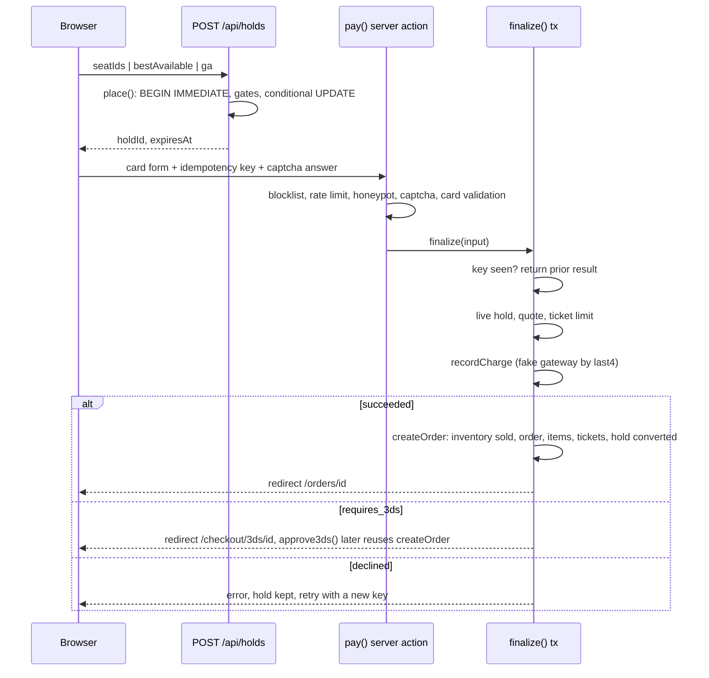
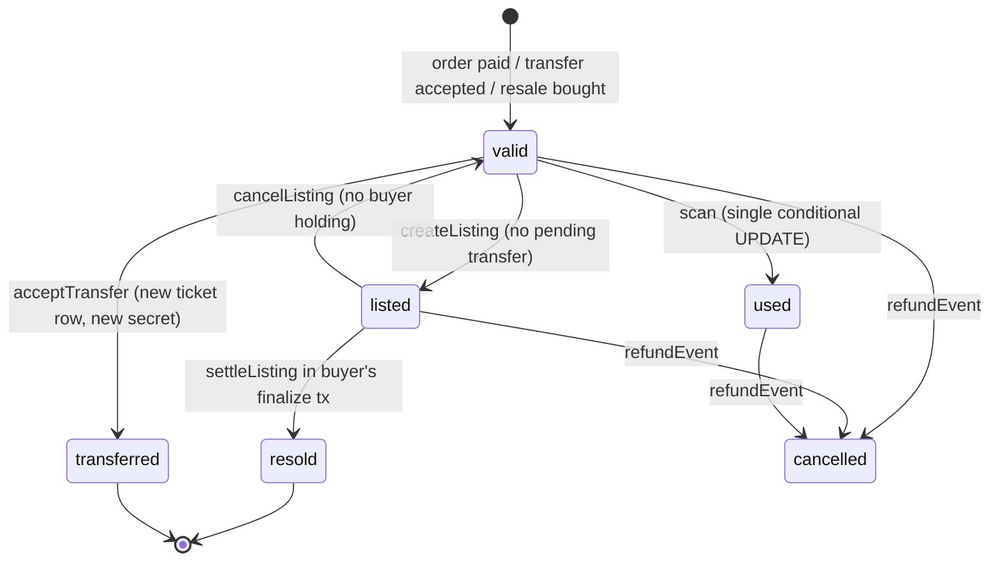
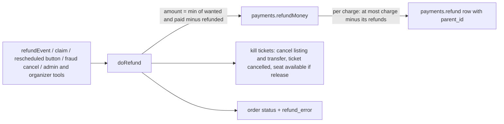

# TicketStorm architecture

Status: all phases of [docs/plan.md](docs/plan.md) are done (P1 to P11, P12A features 1 to 11, P12B features 12 to 22). Statements here describe the code as it is, not the plan.

## Stack and why

| Choice | Why |
|---|---|
| Next.js 15 App Router, React 19, TypeScript | One process and one language for UI, server actions and JSON routes. Server components read the DB directly. |
| SQLite through `node:sqlite` (`DatabaseSync`) | No server, no native build, no ORM. Synchronous API makes `BEGIN IMMEDIATE` transactions trivially correct: one writer at a time, no `await` inside a transaction. RETURNING, partial unique indexes and JSON are available. |
| Plain `node` on `.ts` files (Node >= 23.6 type stripping) | Seed, jobs and tests run without tsx or a bundler. Hence `import './x.ts'` with extensions, `import type`, no `enum`. |
| `node:test` | No test framework dependency. |
| `node:crypto` | scrypt passwords, HMAC for SafeTix and captcha, `timingSafeEqual`. |
| Runtime deps only: `next`, `react`, `react-dom`, `qrcode` | Everything else (seat map, zoom, scanner, math captcha, rate limiter) is hand-written. |

Conventions: money is integer cents; times are UTC ISO strings and venues carry a `tz` for display; `lib/` files import each other by relative path; anything that tests or scripts import must not import `next/*` (cookie code lives only in `lib/session.ts`).

## Directory layout

```
app/            routes (server components), server actions (actions.ts files), route handlers (route.ts)
  api/          events/[id]/inventory, events/[id]/stream (SSE), events/[id]/ics, holds, holds/[id], queue/[eventId], scan, suggest
  organizer/    org-scoped tools; guard.ts loads an event and checks the viewer against ITS org
  admin/ (users, orgs, events, orders, review, claims, refunds, flags, fees, taxes) scan/ checkout/ (3ds/, paypal/) orders/ (+ receipt) tickets/ (+ exchange) transfers/ sell/ listings/ favorites/ queue/ access/
  venues/[slug] artists/[slug] inbox/ unsubscribe/ support/ada/
  account/ (profile, payment, notifications, security, privacy + export)  login/otp  auth/mock/[provider]  dev/outbox
components/     client components: SeatMap, TicketQR, PayForm, QueueRoom, Scanner, Countdown, ...
lib/            all business logic; no React
  schema.sql    the one idempotent schema, applied on every DB open
  db.ts         connection + tx()
  inventory.ts  holds        orders.ts  finalize, refunds, authorization
  payments.ts   fake gateway pricing.ts quotes, fees, dynamic prices, display, promos    safetix.ts  rotating tokens
  transfers.ts resale.ts ledger.ts    scan.ts organizer.ts platform.ts
  fraud.ts installments.ts exchange.ts protection.ts orderadmin.ts    twofa.ts social.ts account.ts
  rules.ts payouts.ts reports.ts (report, CSV, settlement) campaign.ts impersonation.ts ticketstate.ts
  alerts.ts (alert pipeline, unsubscribe tokens)  ics.ts (calendar files)  support.ts (ADA / support tickets)
  queue.ts access.ts defense.ts       session.ts auth.ts jobs.ts notify.ts events.ts geo.ts format.ts venue-gen.ts
scripts/        seed.ts, jobs.ts
tests/          *.test.ts (+ worker files for multi-connection races)
data/           SQLite files (gitignored)
```

## Request flow

- **Pages** are async server components. They call `lib/` functions that run synchronous SQL and render. The root layout calls `runJobsThrottled()` (at most once per 30 seconds, tracked in `settings.last_jobs_run`).
- **Mutations** are server actions (`'use server'` files such as `app/actions.ts`, `app/checkout/actions.ts`, `app/organizer/actions.ts`, `app/admin/actions.ts`). Each action authenticates first, validates input, calls one `lib/` function, then `redirect`s with `?notice=` or `?error=`. Business-rule failures are `UserError` (safe to show) or `HoldError` (carries an HTTP-style status).
- **Route handlers** return JSON for things a client component polls or posts: availability, holds, queue status/join, scanner, suggest. They check `content-type`, validate ids with `Number.isSafeInteger`, and set `Cache-Control: no-store` where state is live.
- **Client components** only hold UI state (seat selection, countdown, camera, QR animation). Every rule is re-checked on the server.

### Checkout sequence



## Data model

Defined in `lib/schema.sql` (`CREATE ... IF NOT EXISTS`, applied on every open; change it, then `npm run reset`; there are no migrations).

**Identity**: `users` (role `fan|admin`, status `active|blocked|deleted`), `sessions` (token PK; `user_id` NULL = guest; indexed on `user_id`), `codes` (verify, reset, otp, vf; single-use via `used_at`), `oauth_links` (`(provider, subject)` UNIQUE; subject is the email in the mock IdP). `codes.attempts` counts wrong OTP guesses.

**Places and people**: `cities` (tax rate in bps), `orgs` (`pending|approved|suspended`), `org_members` (PK `(org_id, user_id)`, roles owner, manager, box_office, scanner, finance), `venues` (org-owned, `tz`), `sections` (`reserved|ga`, SVG path), `seats` (UNIQUE `(section_id,row,number)`; accessible, companion, obstructed flags), `artists`, `artist_related`.

**Events**: `events` (status `draft|published|cancelled|postponed|rescheduled`, `onsale_at`, `hold_minutes`, `ticket_limit`, queue settings, JSON `fee_rule`, `approved`), `event_artists`, `price_levels` (`event_ids` JSON marks a bundle level; `dyn_min_cents`, `dyn_max_cents`, `dyn_k`, `dyn_j` make it dynamic; `perks` text), `offers` (child/senior/student percent, UNIQUE per event), `addons` (kind, price, `inventory`, `sold`, `CHECK sold <= inventory`), `promo_codes` (`org_id` NULL = platform-wide, `event_id` NULL = all events of the org; `CHECK uses <= max_uses`). `events.ticket_limit` is the per-event, per-account cap and `events.order_limit` (NULL = same) the per-order cap.

**Inventory and holds**: one `inventory` row per sellable unit. A reserved seat is one row (`seat_id` set); a GA area is one row per capacity slot (`seat_id` NULL, `slot` set). Status `available|held|sold|blocked`, `block_kind`, `hold_id`, `held_until`, `window_id` (presale window the unit is held back for). UNIQUE `(event_id, seat_id)` and `(event_id, section_id, slot)`. `holds` has `session_token`, `status active|converted|released` and `options` (JSON checkout choices: promo code, offer per inventory id, add-on quantities). `inventory.locked_cents` is the unit face price fixed when the row was held.

**Orders and tickets**: `orders` (`hold_id` is UNIQUE: one order per hold; `idempotency_key` UNIQUE; `access_token` for guest links; `refund_error`; `review_reason`, `fraud_score`; `source` is `comp` or `exchange` for staff-made and exchange orders), `order_items` (kind `ticket|addon|protection|giftcard|fee|discount`; the per-order fee is its own `fee` row, a promo is a negative `discount` row, add-ons one row per unit, so item sums equal the total), `tickets` (status `valid|used|transferred|listed|resold|cancelled|expired`, per-ticket `secret`; either `inventory_id` for a seat or `addon_id` for an add-on pass, enforced by a CHECK), `payments` (kind charge/refund/payout; method card, saved, applepay, googlepay, paypal, installments, exchange; `idempotency_key` UNIQUE; `parent_id` on a refund points at its charge; `due_at` on a pending installment; `meta` JSON with contact and billing, never card number or CVC), `claims` (protection claims), `exchanges`. `order_items.refunded_cents` marks an item refunded on its own, `saved_cards` (brand, last4, exp, fake token).

Key constraint: `one_live_ticket` is `UNIQUE ON tickets(inventory_id) WHERE status IN ('valid','listed','used')`. Even if application logic failed, two live tickets cannot exist for one seat. Add-on passes have a NULL `inventory_id`, which a unique index ignores, so any number of passes can exist.

**Money and ops (P11)**: `payouts` (account `user:ID|org:ID`, status requested/paid/rejected), `settlements` (event_id PK), `orders.src`, `listings.seller_fee_pct`, `events.transfer_rule` / `resale_rule`, `sessions.impersonator_id`.

**Fan to fan**: `transfers` (partial unique `one_pending_transfer` on `ticket_id` where `pending`; random 128-bit `claim_token`), `listings` (partial unique `one_active_listing` on `ticket_id` where `active`; `hold_id` + `held_until` reserve a listing for one buyer), `ledger` (append-only; account `user:ID|org:ID|platform`), `favorites`.

**Access and defense**: `onsale_windows` (kinds public, artist, venue, card, fanclub, promoter, verified_fan, sponsor; registration, lottery and promotion timestamps), `access_codes` (`CHECK (uses <= max_uses)`, optional bound `user_id`), `window_unlocks` (session to window), `vf_registrations` (UNIQUE `(window_id,user_id)`), `queue_entries` (UNIQUE `(event_id, session_token)`; index on `(event_id, admitted_at, rank)`), `rate_limits` (PK `(key, window_start)`; also burns captcha nonces), `blocklist`.

**Engagement (P10)**: `favorites.last_price` (price-drop baseline for event favorites), `alerts_sent` (PK `(user_id, kind, ref)`: one row per alert ever sent), `notifications` (inbox, indexed `(user_id, read_at)`), `support_tickets` (ADA requests now; `messages` JSON thread, P11 adds replies), `users.home_city_id` + `alert_radius_mi`, `events.published_at`.

**Platform**: `settings` (key/value; fee defaults, captcha secret, last job run), `feature_flags`, `audit_log`, `outbox`, `notifications`.

## Core invariants and how they are enforced

### Seat holds (no double-sell)

Every hold path (specific seats, best available, GA, bundle) funnels through `place()` in `lib/inventory.ts`:

1. `tx()` opens `BEGIN IMMEDIATE`, so the writer lock is taken before any read.
2. Inside the same transaction it checks: event exists and is not a draft; the session is admitted by the waiting room (`admittedNow`); the event is buyable (`eventState`); quantity is within the per-order limit (`orderLimit`); the per-event, per-account ticket limit (`assertTicketLimit`).
3. It frees any live hold the same session already has for the event (one hold per session per event, so stacking holds cannot dodge the limit).
4. A `pick` callback chooses candidate inventory ids in the same transaction. Manual selection runs the orphan-seat rule; best available slides a window over each run of adjacent seats in one row (best section rank first) and takes the first window that passes the same rule; ADA seats are kept for accessible requests; bundle seats are skipped unless a level is named.
5. Bundle levels add the same seat in every other event of the bundle, each of which must be on sale.
6. One conditional UPDATE claims everything:

```sql
UPDATE inventory SET status='held', hold_id=?, held_until=?
WHERE event_id IN (...) AND id IN (...) AND (window_id IS NULL OR window_id IN (<windows this session unlocked>))
  AND (status='available' OR (status='held' AND held_until < now))
```

7. `changes !== ids.length` throws, which rolls the whole transaction back (all or nothing).
8. `lockPrices` writes `inventory.locked_cents` for every claimed row (the dynamic price at that instant) in the same transaction.

Expiry is **lazy**: a held row whose `held_until` is in the past is simply claimable again; the predicate above and every read query fold the clock in. The `runJobs()` sweep only tidies rows. Release (`releaseHold`) is owner-only by session token.

### Orphan-seat rule

`orphanSeat(row, picked)` in `lib/inventory.ts` is pure: given every seat of a row (free or not) and the numbers being chosen, it returns a free seat that would be left with no free neighbour while sitting next to a chosen seat, or nothing. A gap in the numbering and the row ends count as walls; held (by others), sold, blocked and presale-hidden seats are not free; the caller's old hold is released before the check. Manual selection calls `assertNoOrphans` (loads the whole rows of the chosen seats and throws a `HoldError` naming the seat). Best Available calls `orphanSeat` for every candidate window against the same physical row data. Pre-existing single seats that are not adjacent to the selection are ignored, otherwise nobody could ever buy next to them. Everything runs inside `place()`'s transaction, so the check and the claim see one consistent state.

### Pricing pipeline

1. **Level price**: `dynamicPrice(level, demand)` = `clamp(base x (1 + k x sold% + j x queueFactor), min, max)`; `demand()` reads sold share of the event and the waiting-room depth. Fixed levels (k = j = 0) return the base.
2. **Lock**: `lockPrices` stores the result in `inventory.locked_cents` when the seats are held. `quote()` reads only that column (falling back to the level price for rows without one), so changing k, min, max or demand never changes an open hold, and `finalize` charges exactly what the shopper saw.
3. **Offers** reduce the locked face per ticket (percent from `offers`), chosen at checkout and stored in `holds.options`.
4. **Fees and tax** (`price()`, pure), run on the face after the promo discount (see 5): per ticket `service_pct` of face plus `facility_cents`, tax (city `tax_rate_bps`) on face plus those fees, plus one untaxed per-order fee (`order_cents + delivery_cents`). The rule is built-in defaults, then `settings.fee_defaults` (`/admin/fees`), then the event's `fee_rule`, merged per field on every quote, so an admin change shows up in the next quote.
5. **Promo**: `findPromo` validates code, scope, expiry and uses (one "Invalid promo code" message for every failure); the discount is `min(code value, ticket subtotal)`, spread over the tickets pro rata (`allocate`) before step 4, and also subtracted from the total as its own line. **Add-ons** add `qty x price` to the subtotal with no fees; merch, food and hospitality are taxed at the city rate, parking is not.
6. `total = subtotal + fees + tax - discount`. Display uses the same `price()`: `shown(cents, ctx, allIn)` adds the ticket's own fees and tax when the `allin` cookie is set, and every page that shows a price goes through `displayLevels` / `displayRange` / `shown`, so listings never disagree with checkout.

`quote()` is pure with respect to the hold: it reads locked prices and `holds.options`, so `finalize`, the 3DS approval and the checkout page produce the same answer unless the shopper changes options (then the amounts differ and the 3DS approval is refused with "Price changed").

### Finalize transaction

`finalize()` in `lib/orders.ts` runs in one `tx()`: look up the idempotency key (repeat returns the first result), verify the hold is live and belongs to the session token, quote, re-check the ticket limit (paid tickets for the event on the user's orders **or on any order with the same email, case-insensitive**, so logging out and buying as a guest does not reset it), record the charge. On success `createOrder` runs in the same transaction: mark inventory `sold` with `WHERE hold_id = ? AND status='held' AND held_until > now` and require the exact row count; take the add-on units and the promo use with guarded UPDATEs (`sold + ? <= inventory`, `uses < max_uses`; a miss throws and rolls back the charge too), insert order, ticket / add-on / discount / fee items, tickets with fresh 32-byte secrets (plus a seat-less pass ticket for each parking or hospitality unit), link the payment, convert the hold, optionally save the card, queue the confirmation email. Any failure rolls everything back. A decline commits only its payment row. 3DS payments finalize later through `approve3ds`, which reuses `createOrder` (and flips the payment to `declined/hold_expired` if the hold died meanwhile). `recordCharge` also dedupes on the UNIQUE `idempotency_key`.

### Resale and the ticket state machine



The `expired` ticket status is still never written: `lib/ticketstate.ts` shows a valid ticket of a finished show as "expired (event over)" without rewriting the row. A transfer or resale never mutates the old ticket into the new owner's: a **new** ticket row with a **new secret** is inserted, so the old QR is dead (the scanner admits only `valid`).

Resale holds reserve the *listing*, not inventory: `holdListing` runs one conditional UPDATE on `listings` (`active`, unexpired, not held by a live hold), after the same waiting-room and ticket-limit gates. The buyer pays the seller's asking price through ordinary `quote()` / `finalize()`. `settleListing` runs inside the buyer's finalize transaction before the buyer's ticket is inserted: listing to `sold`, seller ticket to `resold`, seller credited in `ledger` (`resale_credit`), seller notified. The seller fee, buyer fee, rules and ledger are described in "Resale money, ledger and payouts" below.

### Refunds and the ledger on cancel-after-resale

`refundEvent(eventId)` cancels the event, releases live holds, cancels active listings and pending transfers, then refunds each order in its own transaction (idempotent: refunded orders are skipped; orders whose refund failed are retried). A refund failure (test card `0341`) leaves the order `cancelled` with `refund_error` set so `/admin/refunds` can retry; it is never marked `refunded`.

A resold ticket exists on two orders (the original buyer's and the new buyer's) and both are refunded in full. To keep money zero-sum, the seller's resale credit is reversed once per listing: a `ledger` row `resale_credit` with `-price_cents` and `ref = 'listing:ID:reversal'`, guarded by a lookup on that ref. Net effect on the seller's ledger balance after cancellation is zero. Holders other than the buyer (transfer recipients, resale buyers) get an in-app notification.

### Resale money, ledger and payouts (P11)

**Rules.** `lib/rules.ts`: `events.resale_rule` / `transfer_rule` hold only the fields an organizer set, merged over `settings.resale_defaults` (built-ins: enabled, floor 0 percent, ceiling 300, seller fee 10, buyer fee 5) and over "enabled, no deadline" for transfers. `createListing` and `updateListing` check `floor <= price <= ceiling` of the **face** (`faceOf`: `order_items.unit_cents` on the original order line; a ticket from a resale order takes the face of the ticket it replaced). Transfer create and accept both call `assertTransferOpen`. Jobs `expireTransfers` and `expireListings` are conditional UPDATEs, so re-running is harmless.

**Ledger.** One append-only table, double entry: every business event inserts rows that sum to zero, so `select sum(amount) from ledger` is always 0 (tested, and shown on `/admin/payouts`). A row's amount is the change in what the platform owes that account. Accounts: `user:ID`, `org:ID` (drawable balances), `platform` (fees kept), `tax` (owed to the city), `payouts` (requested, not yet paid), `cash` (the real-world other side; negative = money the platform holds).

| Event | Rows (ref) |
|---|---|
| Resale sold (`listing:ID`) | cash -(price + buyer fee + tax); seller +(price - seller fee); platform +seller fee; platform +buyer fee; tax +tax |
| Cancel after resale (`listing:ID:reversal`, once) | every row above negated, so the seller loses exactly the net credit |
| Settlement (`settle:event:ID`, once per event) | cash -collected; org +net; platform +fees and protection; tax +tax |
| Refund after settlement (`refund:payment:ID`) | cash +refund; org -face share; platform -fees share; tax -tax share |
| Payout request (`payout:ID`) | account -X; payouts +X (this reserves the funds) |
| Payout paid (`payout:ID:paid`) | payouts -X; cash +X |
| Payout rejected (`payout:ID:rejected`) | payouts -X; account +X |

**Refunds after settlement.** `reverseAfterSettlement` (in `doRefund`) writes, per refund payment newer than the settlement and once (ref `refund:payment:ID`): cash +amount, org -(amount - platform part - tax part), platform -(amount x (fees + protection) / total), tax -(amount x tax / total). Zero-sum; the organizer balance may go negative and payouts need `amount <= balance`. `reverseResale` (also in `doRefund`, when a resale order ends `refunded`) negates the listing's whole ledger group once.

The buyer fee is the ticket item's `fee_cents` on the resale order (`source = 'resale'`); `quote()` uses a fee rule of just the buyer percent for resale holds, so `sum(unit + fee + tax) == total` as for any order. A seller balance can go negative if a cancellation reverses a credit already paid out; payouts require balance >= amount.

**Payouts.** `requestPayout` runs the balance read, the `payouts` insert and both ledger rows inside one `BEGIN IMMEDIATE` transaction. Because the debit is written with the request, a pending payout can never be spent twice, and concurrent requests serialize on the write lock (tested with 6 connections). `decidePayout` is a conditional UPDATE on `status = 'requested'`.

**Settlement.** `settleEvent` needs the event over (start + 6 hours), not cancelled, and no order in review or with a refund error. `INSERT INTO settlements` on the event PRIMARY KEY is what makes it idempotent. Net to the organizer = face (subtotal - discount) of live orders (paid, partially refunded; resale orders excluded) minus refunds paid on them; fees, protection premiums and tax stay with the platform and the city.

### Impersonation

`lib/impersonation.ts`: an admin (never another admin, never a blocked user) swaps their session for a 1-hour session of the target with `sessions.impersonator_id`. The root layout shows a banner on every page. `requireSelf()` (in `session.ts`) refuses while the session has an impersonator, and is what `requireAdmin`, `requireOrgRole` and every account action (profile, phone, password-confirmed forms, 2FA, saved cards, delete account, payouts) go through; so the impersonator can look and use fan features but cannot change the target's password, 2FA or payment methods, request payouts, run organizer mutations, or reach admin actions. Start and stop (including logout) are written to `audit_log` with the admin as actor. Stopping signs the admin back in with a fresh session.

**Actions by guard.** `requireSelf` / `refuseImpersonation` (refused while impersonating): all `app/account/*` actions, payouts (user and org), `pay` (so no saved-card charge or card saving), `threeDs`, `requestRefund`, `fileClaim`, exchange (hold and confirm), transfers (send, cancel, accept, decline), resale (sell, edit, cancel), support replies, Verified Fan registration, every organizer action (`requireOrgRole`) and every admin action (`requireAdmin`). Allowed while impersonating (view or harmless): all pages, `resendConfirmation`, favorites, inbox read marks, presale code entry, search, holding seats (nothing can be bought), ADA and help forms.

### Audit

`audit(actor, action, target, data)` in `lib/platform.ts` is the only writer. Every exported action in `app/admin/actions.ts` and `app/organizer/actions.ts` calls it (a test greps both files); impersonation audits itself in `lib/impersonation.ts`.

### Order statuses

`orders.status`: `paid` (normal), `review` (held: fraud score, organizer hold or failed installment; `review_reason` says which), `partially_refunded` (some items refunded, live tickets remain), `refunded` (everything refundable returned, tickets cancelled), `cancelled` (voided, or a refund the card refused: `refund_error` is set and admin retries), `pending` (unused). In `review` the tickets stay `valid` in their own table but `scanTicket`, `assertTradable` (transfers and listings) and the ticket page refuse them; `holdOrder` also cancels listings and pending transfers. Ticket limits count `paid`, `review` and `partially_refunded` orders.

### Payment methods

All methods end in `payments` rows and the same `createOrder`. Card and saved card: validated in the `pay` action, outcome keyed on last4. Apple Pay / Google Pay: client-side `PaymentRequest` or a mock confirm dialog; the server records the test Visa 4242 and never receives a wallet token. PayPal: `recordCharge` stores a `pending` row with no card, the shopper approves on `/checkout/paypal/<key>` (the key only resolves for the session that owns the payment), approval runs `approve3ds`. Pay in 4: the first row is charged at checkout with `meta.total` holding the full price (so `createOrder` checks the whole total, not the quarter), `addInstallments` adds three `pending` rows; `chargeDueInstallments` claims each with `WHERE status = 'pending'`. A failed installment puts the order in `review` (see CHANGELOG for the policy). Off-session charges (`offSession`) treat the 3DS card as declined.

### Refund model

`doRefund` in `lib/orders.ts` is the only place that decides what a refund returns and what it cancels; `payments.refundMoney` is the only place that writes refund rows.



- **What is wanted**: everything left (paid minus refunded, optionally minus the protection premium), or the chosen order items (`unit - promo share (+ fee + tax)`; `allocate()` splits the promo over the ticket items exactly as `quote()` did), or nothing (void: only when paid minus refunded is zero, e.g. comps; a paid order must be refunded). Item refunds are refused while pay-in-4 installments are pending; a full cancel voids them and refunds what was collected.
- **Caps**: `refundMoney` and `refund` throw if asked for more than paid minus refunded (per order and per charge); an item with `refunded_cents > 0` cannot be refunded again; an item refund requires a live ticket (`valid` or `listed`). Used, resold and cancelled tickets can only go with a full refund.
- **Seats**: released (`available`) for partial refunds, voids, fraud cancels, rescheduled-window refunds and admin/organizer cancels, and for protection claims on shows that have not started; kept `sold` for event cancellation (the event is closed) and claims after the show started. Add-on units follow the same flag.
- **Gateway failure**: `record: true` (event cancel) keeps the order `cancelled` with `refund_error` for the admin retry; everything else is strict: the UserError rolls the whole tx back, tickets included.
- **Resale**: the seller's credit reversal stays in `refundEvent` (both orders of a resold ticket are refunded only on cancellation); item refunds of a resold ticket are refused because the seller's order no longer has a live ticket.

### Ticket protection

`settings.protection_pct` (default 8) of the ticket face after the promo, chosen with a checkbox stored in `holds.options.protection`. It is an `order_items` row (`protection`) and `orders.protection`, outside `subtotal`, **untaxed and without fees**, so `sum(items) == total` holds. One claim per order (partial unique index). Approval refunds everything except the premium through `doRefund`; seats are released if the show is still ahead, kept sold otherwise.

### Exchange

A ticket can move to another date of the same `series_key`. The new seat is held first (normal hold path), then `completeExchange` runs one tx: new order for the new event (`source = 'exchange'`, one ticket item at the held seat's price with its own fee and tax, no order fee), old ticket cancelled and its seat freed, old item marked refunded. Money: `refundMoney(oldOrder, credit, 'exchange', newOrder)` writes an `exchange` refund row on the old order and an `exchange` charge row on the new one (carrying brand and last4), so both orders balance without cash moving; the difference is a real charge on the stored card (`chargeStored`) or a real refund of the old order. Declines and refused refunds roll everything back, including the new ticket.

### Two-factor login

`users.twofa_enabled` is switched in `/account/security` with the password. After the password step `loginAction` calls `sendOtp` (code row in `codes`, SMS in the outbox) and redirects to `/login/otp?p=<token>`; the token is an HMAC over (session, user, expiry) (`mac` from `lib/defense.ts`), so it only works in the browser session that passed the password check. `verifyOtp` takes the newest unused, unexpired code, counts wrong guesses in `codes.attempts` (5 kills the code), and consumes it with a conditional UPDATE. `devOtp()` is true only when `NODE_ENV=development` **and** `DEV_OTP=1`; then every code is `000000`. Social login also goes through the OTP step for 2FA accounts. While 2FA is on the phone cannot be cleared and changing it needs the password. Social logins are only created or linked for provider-verified emails and are unlinked on password reset.

### Idempotency

Payments: client sends a form key (`[\w-]{8,64}`) generated per page render; `payments.idempotency_key` and `orders.idempotency_key` are UNIQUE. Double-submits return the first result and never charge twice; a declined attempt needs a new key. Other idempotent writes: `generateInventory` (`INSERT OR IGNORE`), `runJobs`, `refundEvent`, the lottery (claimed by setting `lottery_at` with a guarded UPDATE), waitlist promotion (`promoted_at`), and the single-use update patterns for verify/reset codes (`UPDATE ... WHERE used_at IS NULL RETURNING`).

### Add-on passes

A parking or hospitality unit is an `order_items` row of kind `addon` plus a `tickets` row with `inventory_id` NULL and `addon_id` set. It has its own secret, so it shows its own rotating SafeTix QR and verifies and scans exactly like a seat ticket (`scanTicket` resolves the event through `addons` when there is no inventory). Passes are excluded from attendance counts, transfers and resale (those join `inventory`). Merch has no pass. Cancelling the event cancels the pass with the order.

### SafeTix tokens

`lib/safetix.ts`: token is `ticketId.window.HMAC-SHA256(secret, "ticketId:window")` with `window = floor(ms / 15000)`. The browser (`components/TicketQR.tsx`) computes the same value with `crypto.subtle`, so it rotates without a server round-trip. The server accepts the current window plus or minus one (clock skew) and compares with `timingSafeEqual`. A genuine HMAC outside the window is reported as `expired` (stale screenshot); anything else is `invalid`.

### Marketing source

`middleware.ts` copies a valid `?src=` slug into a 30-day cookie; `pay` reads the cookie and `finalize` stores the slug on `orders.src` (checked again with the same regex). A cookie rather than a `sessions` column because login replaces the session token.

### Scanner

`scanTicket` verifies the token for the right event, then admits with `UPDATE tickets SET status='used' ... WHERE id=? AND status='valid'`. Exactly one concurrent scan sees `changes === 1` (tested with 8 connections). Offline replays pass the original scan time, accepted only inside doors-6h to start+12h, otherwise server time is used (see limitations).

## P12A subsystems

### Live availability (SSE)
`GET /api/events/[id]/stream` (`lib/stream.ts`) sends `JSON.stringify(getAvailability(eventId, openWindowIds))` every 3 s only when it changed (else a `: heartbeat` comment). Frames contain seat ids, a status letter and level ids plus GA counts: no hold ids, sessions or holders. A process-wide counter caps open streams at 100 (503 beyond); a stream closes on `req.signal` abort and after 5 minutes (timers cleared, counter released). `SeatMap` opens an `EventSource`, and polls `/inventory` every 5 s whenever the stream errors or is unavailable.

### Service worker and cache rules
`public/sw.js` is network first. It answers only navigations to `/tickets` and `/tickets/<digits>` (from a saved copy, only when the fetch fails) and `/_next/static/*` GETs. `OfflineTickets` (rendered for a logged-in owner on those pages) writes the pages into `ts-tickets-u<userId>` and deletes every other `ts-tickets-*` cache first. Any POST to `/logout`, `/login`, `/signup`, `/auth/*`, `/impersonate/*` (stop viewing as a user) or `/account/privacy` (delete account) clears all `ts-*` caches; the static cache is versioned and old ones are deleted on activate. While an admin impersonates, ticket pages render no `OfflineTickets`, print or party link and the print page is a 404, so the next person on the device never sees the previous person's tickets. Guest (`?t=`) ticket pages are never saved. Because `TicketQR` derives the code with `crypto.subtle` from the secret in the saved page, the QR keeps rotating offline. Limit: the SW cannot read the session cookie, so a saved page is served to whoever opens the browser offline until logout, login or the next online ticket-page load.

### Delivery, print and will-call
`events.print_ok / willcall_ok / non_transferable`; the buyer's choice is `orders.delivery` (`mobile|print|willcall`), checked against the event inside `finalize` (`assertDelivery`). A print ticket page shows a static code `id.p.HMAC(secret, "id:print")`; `scanTicket` honours it only when `print_ok`, and admission is the same conditional `status = 'valid'` UPDATE, so print and mobile codes share one "used" state. `markPickedUp` is a conditional UPDATE on `picked_up_at IS NULL`, org-scoped through `authOrder` and audited. `assertTradable` (used by transfer create/accept and listing create) refuses `non_transferable` events.

### Scalper flags
`orders.ip` (never `local`) and `orders.card_fp` (HMAC of the card number, computed in `pay`, kept only as a fingerprint; `saved_cards.fp` for saved cards). The five published test cards get no fingerprint outside production, so demo buyers are not flagged. `clusters()` groups live non-comp, non-resale orders by event and key and keeps groups with 3 or more distinct accounts. `flagScalpers(orderId)` runs in the order's transaction: it sets `users.flagged` for registered members of a cluster that includes the order and writes an actor-less `scalper.flag` audit row. `cancelCluster` (admin action, audited) recomputes the cluster from the database and calls `refundOrder` per order.

### Guest order lookup
`requestCode` mails a 6-digit code only when order id and email match, storing `mac("lookup:<order>:<code>")` in `lookup_codes` (older codes for the order die). The action layer answers identically either way, rate-limits per IP (all requests) and per order number (matching requests only), and keeps email and order number in a signed httpOnly `/lookup` cookie, never in a URL. `redeemCode` takes the newest unused, unexpired code with fewer than 5 attempts, compares with `timingSafeEqual`, counts wrong guesses, and consumes with a conditional UPDATE. Success returns the guest order's `access_token` (the same credential as the confirmation email) or `null` for an account order, which redirects to login.

### Party links
`userId.eventId.expiry.HMAC(party:...)` with the server secret (`lib/party.ts`); `partyView` selects seat labels and states for that user and event only. Expiry is 12 h after the show; there is no revocation.

### Other
Display currency is a cookie plus a fixed table (`lib/currency.ts`); stored and charged amounts are always USD cents. The protection step stores `holds.options.protection` as `true`, `false` or absent (absent redirects checkout to `/checkout/[id]/protection`). Express checkout is a prefill of `PayForm` plus a server-required CVC for saved cards. SEO: `lib/seo.ts` builds metadata and the sitemap list. Price alerts run inside `runAlerts`, deduplicated by `alerts_sent (user, 'price_target', 'event:<id>:<target cents>')`.

## P12B subsystems

### Offers and reserved listings
`resale_offers` hold the offers; the decision lives on the listing: `reserved_for / reserved_until / offer_price_cents`. `acceptOffer` is one conditional UPDATE (active, not held, not already reserved) inside `tx`, so exactly one accept wins; `IDLE` (no live hold and no live reservation) guards seller edits, cancels and expiry. `rules.listingPrice` is the single SQL expression for "what this buyer pays" (offer price only for the reserved buyer while the reservation is live); `quote` and `settleListing` both use it, so the quoted price, the order lines and the resale ledger group agree. Reservation expiry is lazy like holds.

### Stored value as payment methods
A payment row per source: the card row (possibly 0 cents) plus `giftcard` and `credit` charges created in `createOrder` by `applyStored`, whose guarded updates (`balance_cents >= x`, `INSERT ... SELECT ... WHERE sum >= x`) make overspending impossible even for two concurrent orders; a miss throws and the whole order rolls back. `planStored` is only a read-only split used by `finalize` and the pay action (to skip card validation when fully covered). Refunds go through `refundMoney`/`refund` as before; `refund()` sends stored-value charges back with the same method, and `settleStoredRefunds` (same tx) restores the credit or gift card balance and, unless `reverseAfterSettlement` will, writes the ledger pair. Ledger accounts: `credit:<user>` and `giftcard:<id>` are liabilities; issue/return = `+account, -cash`, spend = `-account, +cash`; after settlement the reversal debits organizer, platform and tax and credits the stored-value account instead of cash. Gift card codes: 16 chars from a 32-letter alphabet, keyed hash at rest (`defense.mac`), 10 lookups a minute.

### Chargebacks
`createOrder` calls `openDispute` for a payment made with the 0259 test card (0341 only makes refunds fail). `resolveDispute` (admin, audited in the action) marks it decided in a conditional UPDATE; "lost" calls `refundInTx(..., { via: 'chargeback' })`: the card part comes back as a refund payment of method `chargeback` that `refund()` never fails (the 0341 failure rule skips it), tickets are cancelled and seats released by the same code as any refund, stored-value parts return to their sources.

### Organizer developer tools
API keys are `tsk_` + 24 random bytes, stored as SHA-256 (fast hash is adequate for 192-bit random secrets); `authenticateKey` also requires an approved org; the org is taken from the key, never the request. Rate limit = `defense.hit('api:key:<id>')`. Webhooks are simulated: `emitWebhook` (inside the causing transaction) writes `outbox(channel='webhook')` rows signed with the webhook's own secret. The embed is a route handler returning inert HTML, excluded from middleware (no cookies), and the only path without `frame-ancestors 'self'` (see `next.config.ts`). Customer export is `reports.customersCsv(orgId)` behind `requireOrgRole(REPORT_ROLES)`.

### Analytics, A/B, i18n
`events_log` is append-only counters with no identity columns (a test asserts the columns). A/B: `ab.bucket(flag, visitorId)` is a pure hash; `session.abVariant` reads the `ab` cookie that `middleware.ts` sets once. i18n: `lib/i18n.ts` dictionaries, language in the `lang` cookie, checkout strings passed to the client form as props.

### Accessibility notes
Landmarks and a skip link in `layout.tsx`; focus and contrast rules at the end of `globals.css`. `SeatMap` uses roving tabindex with arrow-key navigation computed from seat coordinates (`seatKeys`), `role=button`/`aria-pressed`/`aria-label` on every seat and section, and `role=status` for messages. Not covered: automated axe-style audits, screen reader testing, SVG zoom by keyboard beyond the +/- buttons.

## Authentication and authorization

- **Sessions**: random 24-byte token in an httpOnly, `sameSite=lax` cookie (`secure` in production), 30-day row in `sessions`. `ensureSession()` lazily creates a **guest session** (user_id NULL) only in server actions and route handlers that may set cookies; `getSession()` is read-only.
- **Login** issues a fresh token (no fixation) and deletes the old one. In one transaction it carries the guest session's in-flight rows to the new token: active holds (and sets their `user_id`), 3DS payments, guest orders, waiting-room place, and presale unlocks. Logging in mid-checkout does not lose the hold or the queue position.
- **Passwords**: scrypt with 16-byte salt, constant-time compare with a length check. Login failure message is identical for unknown email, wrong password, blocked and rate-limited. Reset flow returns the same response whether or not the account exists, limits to one code per minute, invalidates older codes, consumes the code atomically and signs the user out everywhere.
- **Order and ticket access (no sequential-id IDOR)**: `canViewOrder`: user orders are visible to their owner; guest orders to the buying session token or the emailed `?t=` access token (constant-time compares). A ticket is visible to its current `owner_id`, or via the order rules if it is a guest ticket. Holds and payments are always matched by session token, never by a client-supplied id alone.
- **Order tools**: refund, void, hold, move seats and comps are server actions that load the order first and check the actor against the org of the order's event (`authOrder`); admins use `/admin/orders` and the review queue.
- **Platform admin**: `users.role = 'admin'`, checked by `requireAdmin()` in every admin action and page. State-changing admin actions write `audit_log`.
- **Org scoping**: org roles live in `org_members`. The org used for an authorization check is **always read from the target row** (event, venue), never from the URL or form: `loadEvent` returns 404 when the URL's `orgId` is not the event's real org, then `requireOrgRole(event.org_id, roles)`; server actions look the event/venue up by id and check against that row's `org_id`. `/api/scan` authorizes against the org that owns the event. `MANAGE_ROLES` = owner, manager; `SCAN_ROLES` adds box_office and scanner. New orgs are `pending` and cannot publish until an admin approves; with the `require_event_approval` flag new events stay hidden (`approved = 0`) until approved. Removing the last owner is rejected.
- **Redirect safety**: `next` must match `^/(?![/\\])`; the city redirect uses the referer only if the host matches.

## Waiting room, presales, Verified Fan, bot defense

- **Queue** (`lib/queue.ts`): `joinQueue` is idempotent per `(event, session)`. Before on-sale the rank is random (so arrival order does not matter); after on-sale it is a FIFO sequence. Admission is **lazy**: every poll or gate check runs `admit()` inside a transaction, admitting in rank order up to `min(rate x minutes since on-sale - already admitted, cap - live admitted)`. An admission lasts 10 minutes (`ADMIT_MINUTES`); an expired admission is dropped and re-joining goes to the back. The clock is an injectable `now` parameter (tests use a fake clock). A logged-in user has one place per event: joining from another browser moves the existing entry to that session. The gate is **server-side**: `place()` and `holdListing` call `admittedNow`; a session with an unlocked, open presale window may hold that window's seats without admission (and before the public on-sale), but never public seats (`place()` passes `pub=false` to the visibility predicate). The tickets page applies the same rule, and the tickets page redirects to `/queue/<id>` unless admitted, so there is no client-only check. `QueueRoom` polls `GET /api/queue/<id>` every 5 seconds.
- **Presale windows** (`lib/access.ts`): inventory rows held back by an organizer carry `window_id`. A session sees and can hold those rows only while the window is open and either needs no code or has an unlock row in `window_unlocks` (`openWindowIds`). Availability, best available, GA counts and the hold UPDATE all use the same visibility predicate. Entering a code increments `access_codes.uses` with `WHERE uses < max_uses`, so a code with N uses unlocks N sessions and never N+1; codes can be bound to a user (Verified Fan). `releaseEndedWindows` returns unsold (`status='available'`) presale seats to public sale; held seats keep their window until they free up and a later run releases them.
- **Verified Fan**: `registerVf` inside the registration window; after `reg_ends`, `runLottery` (job) claims the window by setting `lottery_at`, shuffles registrations with `randomInt` (storing each position in `lottery_rank`), selects the first `vf_slots`, issues one-use user-bound codes (email, SMS, in-app) and waitlists the rest. After `vf_buy_by`, `promoteWaitlist` revokes codes of selected fans with no paid order (status `expired`, their session unlocks deleted, in-app notice) and gives the same number of waitlisted fans a code, in `lottery_rank` order. Statuses: `registered`, `selected`, `waitlisted`, `expired`.
- **Ticket limits**: `order_limit` caps one hold; `ticket_limit` is per account (and per email at finalize) across paid orders, live holds from other sessions, and the new quantity. Guests are limited per hold at hold time and by email at finalize. Resale buys count too.
- **Bot defense** (`lib/defense.ts`): fixed-window counters in one upsert (`rate_limits`), keyed per action per IP and per account; per-IP keys use the client IP rules in `clientIp` (`TRUST_PROXY`); HMAC-derived math captcha whose nonce is burned on first use; honeypot field; `blocklist` for IPs and emails. Applied to login, queue join, checkout and presale code entry.

## Search, ranking and recommendations

`searchEvents` (`lib/events.ts`) builds one SQL statement: visibility, category, genre, venue slug, text (`LIKE` on title, venue, city, artist), city, and `EXISTS` subqueries for accessible (a still-buyable accessible inventory row for that event), resale (active listing on a listed ticket of that event) and presale (a window that has not ended). Sorting by relevance, date and popularity is in SQL (`ORDER BY`); radius, venue-local dates, price and distance run in JS over the rows that survive, because they need haversine, `Intl` or the all-in math. The price columns are scalar subqueries on `price_levels(event_id)`, so nothing is queried per event; all-in prices come from `shown()` with the fee rule and city tax carried on the same row. The one exception is an event with a demand-priced level, which uses `displayRange` so the filter agrees with the number on its card. `min`/`max` apply to the all-in or face price the viewer sees (the cookie is passed in), and an event matches when its range overlaps. Distance sort measures from the city filter or the `city` cookie.

Recommendations (`recommendedEvents`): `score = 2 * min(genre overlap, 3) + 6 * followed artist + 4 * 0.5^(km / 150) + 3 * popularity / 100`. The genre profile is one `UNION ALL` of favorited events, past orders and followed artists' genres; candidates come from one query with the artist ids aggregated per event. Guests have an empty profile, so ranking falls back to popularity and distance.

## Notifications pipeline

`lib/alerts.ts` is the only place alerts are delivered.

- **Idempotency**: `alertUser(user, category, kind, ref, msg)` inserts `(user, kind, ref)` into `alerts_sent` first; a conflict means "already sent" and nothing is delivered. The insert and the deliveries share a transaction (the jobs run inside `tx()`, `finalize` inside its own), so a rollback also rolls the record back. `ref` is chosen so that what must not repeat is the key: `event:<id>` for new-show and on-sale, `event:<id>:<price>` for price drops (a further, lower price is a new alert; a price already announced never is), `order:<id>` / `transfer:<id>` for deliveries.
- **Channels**: optional categories (`alerts`, `marketing`) times channels (`inapp`, `email`, `sms`) in `users.notif_prefs`; inbox rows are `notifications`, email and SMS are outbox rows. `emailUser` is the door for optional email: it checks the preference and appends the unsubscribe footer. **Essential** messages (orders, tickets, transfers, event changes; category `orders` in `alertUser`) have no preference: always sent with `sendEmail`, no footer.
- **Jobs**: `runJobs()` ends with `runAlerts()`. New-show and on-sale alerts find fans with a join from `events` to `favorites` (event, venue, artist branches, `UNION`), skipping pairs already in `alerts_sent` in SQL, then apply the alert radius (haversine from the home city; no home city = no filter). Price drops compare each favorited event's cheapest non-bundle face price with `favorites.last_price` and update it. "New" means `coalesce(published_at, created_at) > favorites.created_at`, so following an artist never replays old announcements.
- **Event changes, tickets, transfers**: the existing cancel/postpone/reschedule code still does the notifying (essential, always sent); ticket delivered and transfer received call `alertUser` at the moment they happen.

### Unsubscribe tokens

`<userId>.<category>.<hex HMAC-SHA256>` where the HMAC is over `unsub:<userId>:<category>` with the server secret kept in `settings` (`lib/defense.ts mac`). `verifyUnsub` checks the shape, that the category is known, and compares signatures with `timingSafeEqual`; a changed user id, category or signature fails. `/unsubscribe` needs no login: GET only shows a confirm form (scanners fetch links), POST sets only `<category>_email` to false. Tokens do not expire (an unsubscribe link should keep working); a forged one cannot be made without the secret.

### Companion seats

A seat's companion is found, not stored: the seat in the same section and row, number +/- 1, with `companion = 1` (the next number wins). `holdSeats` expands the selection with `companionsFor` inside the `place()` callback, so it is the same transaction and the same conditional `UPDATE`: both seats or neither. After expansion it re-checks the per-order and per-account ticket limits (the caller's own old hold is already freed at that point), refuses with a clear message if the companion is taken, and runs the orphan-seat rule over the whole set. `companion: false` skips it. Because the link is adjacency, the chart editor's per-seat accessible/companion toggles keep working with no extra column.

## Background jobs

`runJobs()` (called by `npm run jobs` and, throttled to once per 30 seconds, by the root layout): in one transaction delete expired sessions and codes, return expired held inventory to `available` and mark expired holds `released`, drop old rate-limit rows and long-expired queue entries, release ended presale windows, record `last_jobs_run`. Then run the Verified Fan lottery and waitlist promotion (each in its own transaction, each idempotent) `chargeDueInstallments()` (pay in 4: one claimed row per transaction) `runAlerts()` (new-show, on-sale and price-drop alerts, idempotent through `alerts_sent`) and `runDigest()` (weekly digest, once per user per ISO week through `alerts_sent`). Correctness never depends on jobs because expiry is lazy.

## Simulated external systems

- Email and SMS: `lib/notify.ts` writes to `outbox` and logs to the console; `/dev/outbox` lists the newest 200 and linkifies URLs; it is hidden when `NODE_ENV=production`.
- In-app notifications (push stand-in): `notifications` rows via `notify()`; read at `/inbox`.
- Social login: `/auth/mock/[provider]` is a fake consent screen (404 in production). SMS 2FA codes and order texts go to the outbox.
- Payments: `lib/payments.ts`, behaviour keyed on last4. Card numbers and CVCs exist only in the request that carries them. Refunds are rows in `payments` with kind `refund`.
- Camera scanning uses `BarcodeDetector` with a paste fallback. Wallet passes are mock JSON, NFC is a `BroadcastChannel` demo to the scanner page, payouts are ledger rows that an admin marks paid. No OAuth.

## Testing strategy

`node:test`, run with `npm test`. Every suite points `TICKETSTORM_DB` at a temp file before importing `lib/db.ts`, so `data/` is never touched.

- **Concurrency is tested with real separate connections**: `tests/holds.worker.ts`, `scan.worker.ts` and `resale.worker.ts` run in `worker_threads`, each opening its own connection to the same file. Tests assert no double holds across 8 workers x 200 iterations with all-or-nothing batches, exactly one winner when 8 connections scan the same ticket, and exactly one buyer when two connections buy the same listing.
- Pure logic with injectable time: pricing math, Luhn and test cards, SafeTix windows, queue admission (fake clock), captcha single-use, rate limiting.
- Flow tests against a real schema (P10: ICS, unsubscribe tokens, alert idempotency through repeated job runs, companion holds, search filters and sorts; P9: shared refund caps and partial/void/event refunds, exchange both directions and twice in a row, declined difference, pay in 4 plan and job idempotency, OTP, fraud review gating, protection claims, move seat, comps, social state, account export/delete): payments (idempotency, declines keep the hold, 3DS, expired or foreign hold creates nothing, `one_live_ticket`), order authorization, organizer rules (publish gating, killed rows, doors/on-sale validation), refunds (idempotent, failed refund flagged), reschedule, transfers (old QR dies), resale (ledger credited, own-listing refused, cancel-after-resale reverses credit once), presale and Verified Fan.
- Not covered by automated tests: React components, page rendering, route handlers' HTTP layer, the browser-side QR computation.

## Known limitations and deferrals

Marked `ponytail:` in code:

- `lib/scan.ts`: staff-supplied scan timestamps are trusted when inside the event-day window (doors minus 6 hours to start plus 12 hours); a scanner device could back-date within it. Fix would be signing queued scans on-device or capping by server receive time.
- `lib/orders.ts`: a bundle order is refunded and cancelled whole when any one game in it is cancelled.
- `lib/defense.ts`: without `TRUST_PROXY=1` all callers share the IP `local` (per-IP limits and IP blocklist are effectively global); with it the last `x-forwarded-for` entry is used, which is only correct behind exactly one proxy that appends to the header.
- `lib/queue.ts`: accounts are deduplicated per event when they join logged in; anonymous joins from different browsers each get a place (bounded by the 5/min per-IP join limit and the captcha). Logging in from several browsers that already queued anonymously leaves duplicate entries until the next join.

Other known gaps:

- Add-ons carry no service or facility fee (parking is also untaxed). Offers are not locked at hold time. The seat map shows dynamic prices as of page load. Queue-depth demand (`j`) is the people waiting (joined or polled in the last 2 minutes) divided by 100, a fixed constant.
- P11 deferrals: settlement is manual (owner/finance press Settle), a partial refund is taken from the organizer share even if it returned fees and tax (`ponytail:` in `lib/reports.ts`), campaigns do not reach guest buyers (no preference to check), the `?src=` cookie is last-touch for 30 days, the NFC tap works only within one browser.
- P9 deferrals (`ponytail:` in code): a failed installment is not retried automatically; an item refund on a pay-in-4 order is capped at what was paid; exchange refuses promo, bundle and installment orders; the 2FA phone number is not verified when 2FA is turned on; wallet payments are simulated (no token); the mock IdP trusts whatever identity is typed (disabled in production).
- Email/SMS are outbox-only. Preferences apply to optional alerts and marketing only; order, ticket, transfer and event-change messages are essential and ignore them.
- P10: price drops compare base face price only; ICS end time is a fixed 3 hours; the venue map is a schematic SVG, not tiles; on-sale reminders depend on the jobs running in the hour before on-sale; the companion link is adjacency, so a chart where the companion is not beside the accessible seat gets no auto-hold.
- P12B deferrals: webhooks are logged, not delivered or retried; the digest scores every user in one job run (fine for a demo, batch it for real volume); third-party resale and vendor linking remain labelled placeholders; the A/B visitor id is a cookie, so cookie-less visitors all share one bucket; stored value cannot be used with pay in 4; a gift card is not a transferable object (redeem to credit or use at checkout); only nav and checkout are translated.
- Single process, single SQLite file; `place()` serializes all writers on the database lock.
- Dev database is disposable: schema changes require `npm run reset`.
- Guests are limited only per hold (the per-account limit needs a user id).
