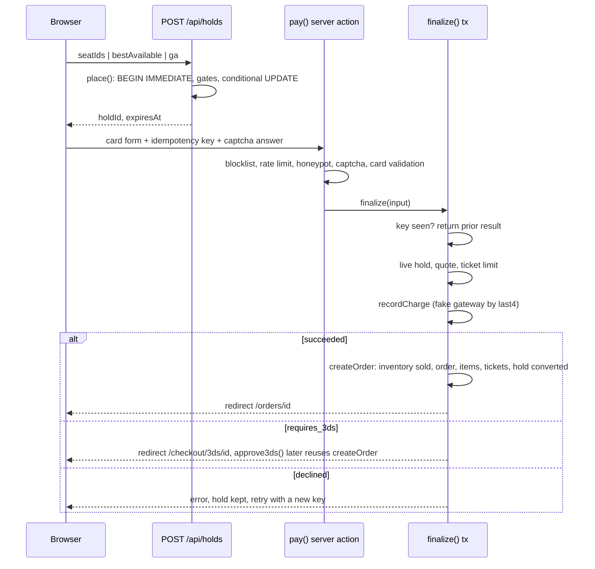
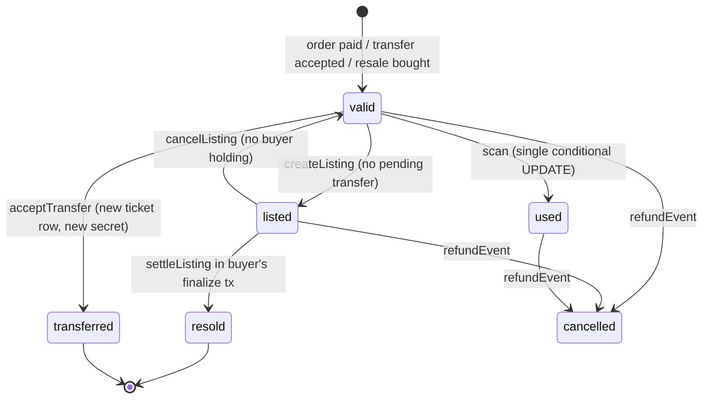

# TicketStorm architecture

Status: P1 to P7 of [docs/plan.md](docs/plan.md). Statements here describe the code as it is, not the plan.

## Stack and why

| Choice | Why |
|---|---|
| Next.js 15 App Router, React 19, TypeScript | One process and one language for UI, server actions and JSON routes. Server components read the DB directly. |
| SQLite through `node:sqlite` (`DatabaseSync`) | No server, no native build, no ORM. Synchronous API makes `BEGIN IMMEDIATE` transactions trivially correct: one writer at a time, no `await` inside a transaction. RETURNING, partial unique indexes and JSON are available. |
| Plain `node` on `.ts` files (Node >= 23.6 type stripping) | Seed, jobs and tests run without tsx or a bundler. Hence `import './x.ts'` with extensions, `import type`, no `enum`. |
| `node:test` | No test framework dependency. |
| `node:crypto` | scrypt passwords, HMAC for SafeTix and captcha, `timingSafeEqual`. |
| Runtime deps only: `next`, `react`, `react-dom`, `qrcode` | Everything else (seat map, zoom, scanner, math captcha, rate limiter) is hand-written. |

Conventions: money is integer cents; times are UTC ISO strings and venues carry a `tz` for display; `lib/` files import each other by relative path; anything that tests or scripts import must not import `next/*` (cookie code lives only in `lib/session.ts`).

## Directory layout

```
app/            routes (server components), server actions (actions.ts files), route handlers (route.ts)
  api/          events/[id]/inventory, holds, holds/[id], queue/[eventId], scan, suggest
  organizer/    org-scoped tools; guard.ts loads an event and checks the viewer against ITS org
  admin/ scan/ checkout/ orders/ tickets/ transfers/ sell/ listings/ favorites/ queue/ access/ dev/outbox
components/     client components: SeatMap, TicketQR, PayForm, QueueRoom, Scanner, Countdown, ...
lib/            all business logic; no React
  schema.sql    the one idempotent schema, applied on every DB open
  db.ts         connection + tx()
  inventory.ts  holds        orders.ts  finalize, refunds, authorization
  payments.ts   fake gateway pricing.ts quotes    safetix.ts  rotating tokens
  transfers.ts resale.ts ledger.ts    scan.ts organizer.ts platform.ts
  queue.ts access.ts defense.ts       session.ts auth.ts jobs.ts notify.ts events.ts geo.ts format.ts venue-gen.ts
scripts/        seed.ts, jobs.ts
tests/          *.test.ts (+ worker files for multi-connection races)
data/           SQLite files (gitignored)
```

## Request flow

- **Pages** are async server components. They call `lib/` functions that run synchronous SQL and render. The root layout calls `runJobsThrottled()` (at most once per 30 seconds, tracked in `settings.last_jobs_run`).
- **Mutations** are server actions (`'use server'` files such as `app/actions.ts`, `app/checkout/actions.ts`, `app/organizer/actions.ts`, `app/admin/actions.ts`). Each action authenticates first, validates input, calls one `lib/` function, then `redirect`s with `?notice=` or `?error=`. Business-rule failures are `UserError` (safe to show) or `HoldError` (carries an HTTP-style status).
- **Route handlers** return JSON for things a client component polls or posts: availability, holds, queue status/join, scanner, suggest. They check `content-type`, validate ids with `Number.isSafeInteger`, and set `Cache-Control: no-store` where state is live.
- **Client components** only hold UI state (seat selection, countdown, camera, QR animation). Every rule is re-checked on the server.

### Checkout sequence



## Data model

Defined in `lib/schema.sql` (`CREATE ... IF NOT EXISTS`, applied on every open; change it, then `npm run reset`; there are no migrations).

**Identity**: `users` (role `fan|admin`, status `active|blocked|deleted`), `sessions` (token PK; `user_id` NULL = guest; indexed on `user_id`), `codes` (verify, reset, otp, vf; single-use via `used_at`), `oauth_links` (schema only).

**Places and people**: `cities` (tax rate in bps), `orgs` (`pending|approved|suspended`), `org_members` (PK `(org_id, user_id)`, roles owner, manager, box_office, scanner, finance), `venues` (org-owned, `tz`), `sections` (`reserved|ga`, SVG path), `seats` (UNIQUE `(section_id,row,number)`; accessible, companion, obstructed flags), `artists`, `artist_related`.

**Events**: `events` (status `draft|published|cancelled|postponed|rescheduled`, `onsale_at`, `hold_minutes`, `ticket_limit`, queue settings, JSON `fee_rule`, `approved`), `event_artists`, `price_levels` (`event_ids` JSON marks a bundle level), `offers` (schema only).

**Inventory and holds**: one `inventory` row per sellable unit. A reserved seat is one row (`seat_id` set); a GA area is one row per capacity slot (`seat_id` NULL, `slot` set). Status `available|held|sold|blocked`, `block_kind`, `hold_id`, `held_until`, `window_id` (presale window the unit is held back for). UNIQUE `(event_id, seat_id)` and `(event_id, section_id, slot)`. `holds` has `session_token`, `status active|converted|released`.

**Orders and tickets**: `orders` (`hold_id` is UNIQUE: one order per hold; `idempotency_key` UNIQUE; `access_token` for guest links; `refund_error`), `order_items` (kind `ticket|addon|protection|giftcard|fee`; the per-order processing fee is its own `fee` row so item sums equal the total), `tickets` (status `valid|used|transferred|listed|resold|cancelled|expired`, per-ticket `secret`), `payments` (kind charge/refund/payout, `idempotency_key` UNIQUE, `meta` JSON with contact and billing, never card number or CVC), `saved_cards` (brand, last4, exp, fake token).

Key constraint: `one_live_ticket` is `UNIQUE ON tickets(inventory_id) WHERE status IN ('valid','listed','used')`. Even if application logic failed, two live tickets cannot exist for one seat.

**Fan to fan**: `transfers` (partial unique `one_pending_transfer` on `ticket_id` where `pending`; random 128-bit `claim_token`), `listings` (partial unique `one_active_listing` on `ticket_id` where `active`; `hold_id` + `held_until` reserve a listing for one buyer), `ledger` (append-only; account `user:ID|org:ID|platform`), `favorites`.

**Access and defense**: `onsale_windows` (kinds public, artist, venue, card, fanclub, promoter, verified_fan, sponsor; registration, lottery and promotion timestamps), `access_codes` (`CHECK (uses <= max_uses)`, optional bound `user_id`), `window_unlocks` (session to window), `vf_registrations` (UNIQUE `(window_id,user_id)`), `queue_entries` (UNIQUE `(event_id, session_token)`; index on `(event_id, admitted_at, rank)`), `rate_limits` (PK `(key, window_start)`; also burns captcha nonces), `blocklist`.

**Platform**: `settings` (key/value; fee defaults, captcha secret, last job run), `feature_flags`, `audit_log`, `outbox`, `notifications`.

## Core invariants and how they are enforced

### Seat holds (no double-sell)

Every hold path (specific seats, best available, GA, bundle) funnels through `place()` in `lib/inventory.ts`:

1. `tx()` opens `BEGIN IMMEDIATE`, so the writer lock is taken before any read.
2. Inside the same transaction it checks: event exists and is not a draft; the session is admitted by the waiting room (`admittedNow`); the event is buyable (`eventState`); quantity is within `ticket_limit`; the per-account ticket limit (`assertTicketLimit`).
3. It frees any live hold the same session already has for the event (one hold per session per event, so stacking holds cannot dodge the limit).
4. A `pick` callback chooses candidate inventory ids in the same transaction (for best available it scans a joined, ordered result for the first run of adjacent seats in one row; ADA seats are kept for accessible requests; bundle seats are skipped unless a level is named).
5. Bundle levels add the same seat in every other event of the bundle, each of which must be on sale.
6. One conditional UPDATE claims everything:

```sql
UPDATE inventory SET status='held', hold_id=?, held_until=?
WHERE event_id IN (...) AND id IN (...) AND (window_id IS NULL OR window_id IN (<windows this session unlocked>))
  AND (status='available' OR (status='held' AND held_until < now))
```

7. `changes !== ids.length` throws, which rolls the whole transaction back (all or nothing).

Expiry is **lazy**: a held row whose `held_until` is in the past is simply claimable again; the predicate above and every read query fold the clock in. The `runJobs()` sweep only tidies rows. Release (`releaseHold`) is owner-only by session token.

### Finalize transaction

`finalize()` in `lib/orders.ts` runs in one `tx()`: look up the idempotency key (repeat returns the first result), verify the hold is live and belongs to the session token, quote, re-check the ticket limit, record the charge. On success `createOrder` runs in the same transaction: mark inventory `sold` with `WHERE hold_id = ? AND status='held' AND held_until > now` and require the exact row count; insert order, ticket and fee items, tickets with fresh 32-byte secrets, link the payment, convert the hold, optionally save the card, queue the confirmation email. Any failure rolls everything back. A decline commits only its payment row. 3DS payments finalize later through `approve3ds`, which reuses `createOrder` (and flips the payment to `declined/hold_expired` if the hold died meanwhile). `recordCharge` also dedupes on the UNIQUE `idempotency_key`.

### Resale and the ticket state machine



`expired` exists in the schema but nothing sets it yet. A transfer or resale never mutates the old ticket into the new owner's: a **new** ticket row with a **new secret** is inserted, so the old QR is dead (the scanner admits only `valid`).

Resale holds reserve the *listing*, not inventory: `holdListing` runs one conditional UPDATE on `listings` (`active`, unexpired, not held by a live hold), after the same waiting-room and ticket-limit gates. The buyer pays the seller's asking price through ordinary `quote()` / `finalize()`. `settleListing` runs inside the buyer's finalize transaction before the buyer's ticket is inserted: listing to `sold`, seller ticket to `resold`, seller credited in `ledger` (`resale_credit`), seller notified. There is no seller fee yet (planned for P11).

### Refunds and the ledger on cancel-after-resale

`refundEvent(eventId)` cancels the event, releases live holds, cancels active listings and pending transfers, then refunds each order in its own transaction (idempotent: refunded orders are skipped; orders whose refund failed are retried). A refund failure (test card `0341`) leaves the order `cancelled` with `refund_error` set so `/admin/refunds` can retry; it is never marked `refunded`.

A resold ticket exists on two orders (the original buyer's and the new buyer's) and both are refunded in full. To keep money zero-sum, the seller's resale credit is reversed once per listing: a `ledger` row `resale_credit` with `-price_cents` and `ref = 'listing:ID:reversal'`, guarded by a lookup on that ref. Net effect on the seller's ledger balance after cancellation is zero. Holders other than the buyer (transfer recipients, resale buyers) get an in-app notification.

### Idempotency

Payments: client sends a form key (`[\w-]{8,64}`) generated per page render; `payments.idempotency_key` and `orders.idempotency_key` are UNIQUE. Double-submits return the first result and never charge twice; a declined attempt needs a new key. Other idempotent writes: `generateInventory` (`INSERT OR IGNORE`), `runJobs`, `refundEvent`, the lottery (claimed by setting `lottery_at` with a guarded UPDATE), waitlist promotion (`promoted_at`), and the single-use update patterns for verify/reset codes (`UPDATE ... WHERE used_at IS NULL RETURNING`).

### SafeTix tokens

`lib/safetix.ts`: token is `ticketId.window.HMAC-SHA256(secret, "ticketId:window")` with `window = floor(ms / 15000)`. The browser (`components/TicketQR.tsx`) computes the same value with `crypto.subtle`, so it rotates without a server round-trip. The server accepts the current window plus or minus one (clock skew) and compares with `timingSafeEqual`. A genuine HMAC outside the window is reported as `expired` (stale screenshot); anything else is `invalid`.

### Scanner

`scanTicket` verifies the token for the right event, then admits with `UPDATE tickets SET status='used' ... WHERE id=? AND status='valid'`. Exactly one concurrent scan sees `changes === 1` (tested with 8 connections). Offline replays pass the original scan time, accepted only inside doors-6h to start+12h, otherwise server time is used (see limitations).

## Authentication and authorization

- **Sessions**: random 24-byte token in an httpOnly, `sameSite=lax` cookie (`secure` in production), 30-day row in `sessions`. `ensureSession()` lazily creates a **guest session** (user_id NULL) only in server actions and route handlers that may set cookies; `getSession()` is read-only.
- **Login** issues a fresh token (no fixation) and deletes the old one. In one transaction it carries the guest session's in-flight rows to the new token: active holds (and sets their `user_id`), 3DS payments, guest orders, waiting-room place, and presale unlocks. Logging in mid-checkout does not lose the hold or the queue position.
- **Passwords**: scrypt with 16-byte salt, constant-time compare with a length check. Login failure message is identical for unknown email, wrong password, blocked and rate-limited. Reset flow returns the same response whether or not the account exists, limits to one code per minute, invalidates older codes, consumes the code atomically and signs the user out everywhere.
- **Order and ticket access (no sequential-id IDOR)**: `canViewOrder`: user orders are visible to their owner; guest orders to the buying session token or the emailed `?t=` access token (constant-time compares). A ticket is visible to its current `owner_id`, or via the order rules if it is a guest ticket. Holds and payments are always matched by session token, never by a client-supplied id alone.
- **Platform admin**: `users.role = 'admin'`, checked by `requireAdmin()` in every admin action and page. State-changing admin actions write `audit_log`.
- **Org scoping**: org roles live in `org_members`. The org used for an authorization check is **always read from the target row** (event, venue), never from the URL or form: `loadEvent` returns 404 when the URL's `orgId` is not the event's real org, then `requireOrgRole(event.org_id, roles)`; server actions look the event/venue up by id and check against that row's `org_id`. `/api/scan` authorizes against the org that owns the event. `MANAGE_ROLES` = owner, manager; `SCAN_ROLES` adds box_office and scanner. New orgs are `pending` and cannot publish until an admin approves; with the `require_event_approval` flag new events stay hidden (`approved = 0`) until approved. Removing the last owner is rejected.
- **Redirect safety**: `next` must match `^/(?![/\\])`; the city redirect uses the referer only if the host matches.

## Waiting room, presales, Verified Fan, bot defense

- **Queue** (`lib/queue.ts`): `joinQueue` is idempotent per `(event, session)`. Before on-sale the rank is random (so arrival order does not matter); after on-sale it is a FIFO sequence. Admission is **lazy**: every poll or gate check runs `admit()` inside a transaction, admitting in rank order up to `min(rate x minutes since on-sale - already admitted, cap - live admitted)`. An admission lasts 10 minutes (`ADMIT_MINUTES`); an expired admission is dropped and re-joining goes to the back. The clock is an injectable `now` parameter (tests use a fake clock). The gate is **server-side**: `place()` and `holdListing` call `admittedNow`, and the tickets page redirects to `/queue/<id>` unless admitted, so there is no client-only check. `QueueRoom` polls `GET /api/queue/<id>` every 5 seconds.
- **Presale windows** (`lib/access.ts`): inventory rows held back by an organizer carry `window_id`. A session sees and can hold those rows only while the window is open and either needs no code or has an unlock row in `window_unlocks` (`openWindowIds`). Availability, best available, GA counts and the hold UPDATE all use the same visibility predicate. Entering a code increments `access_codes.uses` with `WHERE uses < max_uses`, so a code with N uses unlocks N sessions and never N+1; codes can be bound to a user (Verified Fan). `releaseEndedWindows` returns unsold presale seats to public sale.
- **Verified Fan**: `registerVf` inside the registration window; after `reg_ends`, `runLottery` (job) claims the window by setting `lottery_at`, shuffles registrations with `randomInt`, selects the first `vf_slots`, issues one-use user-bound codes (email, SMS, in-app) and waitlists the rest. After `vf_buy_by`, `promoteWaitlist` revokes codes of selected fans with no paid order and gives the same number of waitlisted fans a code.
- **Ticket limit** is per account across paid orders, live holds from other sessions, and the new quantity. Guests are limited only per hold. Resale buys count too.
- **Bot defense** (`lib/defense.ts`): fixed-window counters in one upsert (`rate_limits`), keyed per action per IP and per account; HMAC-derived math captcha whose nonce is burned on first use; honeypot field; `blocklist` for IPs and emails. Applied to login, queue join, checkout and presale code entry.

## Background jobs

`runJobs()` (called by `npm run jobs` and, throttled to once per 30 seconds, by the root layout): in one transaction delete expired sessions and codes, return expired held inventory to `available` and mark expired holds `released`, drop old rate-limit rows and long-expired queue entries, release ended presale windows, record `last_jobs_run`. Then run the Verified Fan lottery and waitlist promotion (each in its own transaction, each idempotent). Correctness never depends on jobs because expiry is lazy.

## Simulated external systems

- Email and SMS: `lib/notify.ts` writes to `outbox` and logs to the console; `/dev/outbox` lists the newest 200 and linkifies URLs; it is hidden when `NODE_ENV=production`.
- In-app notifications (push stand-in): `notifications` rows via `notify()`; no UI yet.
- Payments: `lib/payments.ts`, behaviour keyed on last4. Card numbers and CVCs exist only in the request that carries them. Refunds are rows in `payments` with kind `refund`.
- Camera scanning uses `BarcodeDetector` with a paste fallback. No OAuth, wallet, NFC or payouts.

## Testing strategy

`node:test`, run with `npm test`. Every suite points `TICKETSTORM_DB` at a temp file before importing `lib/db.ts`, so `data/` is never touched.

- **Concurrency is tested with real separate connections**: `tests/holds.worker.ts`, `scan.worker.ts` and `resale.worker.ts` run in `worker_threads`, each opening its own connection to the same file. Tests assert no double holds across 8 workers x 200 iterations with all-or-nothing batches, exactly one winner when 8 connections scan the same ticket, and exactly one buyer when two connections buy the same listing.
- Pure logic with injectable time: pricing math, Luhn and test cards, SafeTix windows, queue admission (fake clock), captcha single-use, rate limiting.
- Flow tests against a real schema: payments (idempotency, declines keep the hold, 3DS, expired or foreign hold creates nothing, `one_live_ticket`), order authorization, organizer rules (publish gating, killed rows, doors/on-sale validation), refunds (idempotent, failed refund flagged), reschedule, transfers (old QR dies), resale (ledger credited, own-listing refused, cancel-after-resale reverses credit once), presale and Verified Fan.
- Not covered by automated tests: React components, page rendering, route handlers' HTTP layer, the browser-side QR computation.

## Known limitations and deferrals

Marked `ponytail:` in code:

- `lib/scan.ts`: staff-supplied scan timestamps are trusted when inside the event-day window (doors minus 6 hours to start plus 12 hours); a scanner device could back-date within it. Fix would be signing queued scans on-device or capping by server receive time.
- `lib/orders.ts`: a bundle order is refunded and cancelled whole when any one game in it is cancelled.
- `lib/defense.ts`: client IP is the first `x-forwarded-for` hop, which a client can spoof without a trusted proxy. Add trusted-proxy configuration when deployed.

Other known gaps:

- Pre-P8 pricing only: no dynamic pricing, add-ons, promo codes, offers (tables `offers` exist but are unused), no orphan-seat rule.
- No seller fee, payouts, or per-event transfer/resale rules (P11). Ticket status `expired` and transfer expiry are checked lazily but no job sets them.
- No 2FA, social login, account pages, protection, partial refunds or exchanges (P9). `oauth_links` and `codes.kind = 'otp'` are schema only.
- Notifications have no inbox page; email/SMS are outbox-only.
- Single process, single SQLite file; `place()` serializes all writers on the database lock.
- Dev database is disposable: schema changes require `npm run reset`.
- Guests are limited only per hold (the per-account limit needs a user id).
